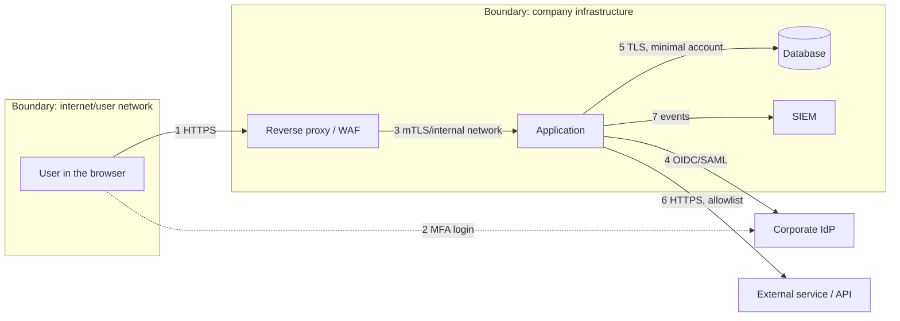

# Short threat model (new application)

Goal: in one hour, list what can go wrong **before** coding and tie each risk to a control and to an ASVS requirement. It follows the four questions of the Threat Modeling Manifesto: what are we building, what can go wrong, what will we do about it, did we do enough?

**Output:** a `docs/modelo-ameacas.md` file in the project, versioned together with the code. **Review** it when the architecture changes (new component, new external service, new data type, change of IdP or hosting), before each major delivery and after an incident. It is not a one-time exercise.

## Step by step

1. Describe the application in one paragraph: who uses it, what data it handles and its classification (V14.1.1), where it runs.
2. Draw the **data flow diagram** (processes, data stores, external entities, flows) and mark the **trust boundaries**: where who controls the data or the level of trust changes. They usually point to the attack points.
3. For each flow that crosses a boundary, walk through **STRIDE**: Spoofing (forging identity), Tampering (altering), Repudiation (denying authorship), Information disclosure (leaking), Denial of service (making unavailable), Elevation of privilege (escalating privilege).
4. Record in the table: threat, control, ASVS ID, owner and status. Whatever is not handled is an **accepted risk** with an owner and a date.

## Example diagram (adapt)

Boundaries: user and proxy/IdP; proxy and application; application and database; application and external services; application and SIEM.

## Threat, control, ASVS table (starting point)

| STRIDE | Threat | Control | ASVS |
|---|---|---|---|
| S | Stolen and reused session or token | `Secure`/`HttpOnly`/`SameSite` cookie, rotation at login, server-side expiry and logout | V7.2.4, V7.3.1, V7.4.1, V3.3.1 |
| S | Identity forged by header or invalid ID Token | Validate signature, `iss`, `aud`, `exp`, `nonce`; application unreachable outside the proxy | V9.1.1, V10.5.4, V6.8.2, V4.1.3 |
| S | Interception of the authorization code | PKCE, `state`, exact redirect URI | V10.4.6, V10.1.2, V10.4.1 |
| T | Injection (SQL, command, template) and XSS | Parameterized query, server-side validation, output encoding, CSP | V1.2.4, V1.2.5, V2.2.2, V1.2.1, V3.4.3 |
| T | Tampering with data in transit or with a token | TLS 1.2+/1.3, token signing | V12.1.1, V12.3.3, V9.1.1 |
| T | Mass assignment changes a protected field | DTO and allowlist of fields | V15.3.3 |
| R | Critical action without an authorship trail | Logging of authentication, denials and administrative actions, protected and sent to the SIEM | V16.3.1, V16.3.2, V16.4.2, V16.4.3 |
| I | Access to another user's (IDOR) or another tenant's object | Per-object authorization; tenant from the session; RLS in the database | V8.2.2, V8.4.1 |
| I | Leak through error, log, URL or cache | Generic error, no sensitive data in logs and URLs, `Cache-Control: no-store` | V16.5.1, V16.2.5, V14.2.1, V14.3.2 |
| I | Secret in code or in the image | Secrets vault, secret scanning in the pipeline | V13.3.1, V13.3.2 |
| I | Sensitive data at rest exposed (backup, disk) | Encryption at rest, approved algorithms | V14.2.4, V11.3.2 |
| D | Excess of requests, uploads or costly queries | Rate limiting, size limits, defenses for costly functions | V2.4.1, V5.2.1, V15.2.2 |
| D | External service failure takes the application down | Timeout, controlled degradation, destination allowlist | V16.5.2, V13.2.4 |
| E | Ordinary profile accesses an administrative function | Deny by default, check in the service layer, separate administration | V8.2.1, V8.3.1 |
| E | SSRF leads to the internal network or cloud metadata | Destination allowlist, do not follow redirects | V1.3.6, V13.2.5, V15.3.2 |
| E | Vulnerable or compromised dependency | SBOM, fix deadlines, trusted source | V15.1.1, V15.1.2, V15.2.1 |
| E | Compromised container moves across the network | Non-root user, NetworkPolicy, minimal database account (`references/infra.md`) | V13.2.2 |

## Template for the `docs/modelo-ameacas.md` file

Header: name, version, date, authors, trigger of the last review. Sections: 1 Description and data; 2 Diagram and boundaries; 3 Assets and actors (including the internal attacker and the malicious user with a valid session); 4 Threat table (columns: id, STRIDE, threat, control, ASVS, status, owner); 5 Accepted risks (owner, justification, validity); 6 Revision history.

## Sources

- OWASP Threat Modeling Cheat Sheet: https://cheatsheetseries.owasp.org/cheatsheets/Threat_Modeling_Cheat_Sheet.html
- OWASP ASVS 5.0.0: https://github.com/OWASP/ASVS/tree/master/5.0
- NIST SP 800-218 (SSDF) v1.1: https://csrc.nist.gov/pubs/sp/800/218/final
