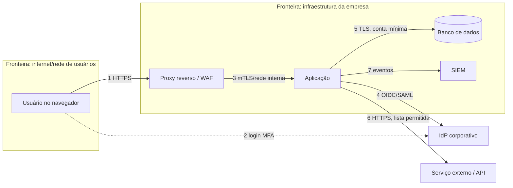

# Modelo de ameaças curto (aplicação nova)

Objetivo: em uma hora, listar o que pode dar errado **antes** de codificar e ligar cada risco a um controle e a um requisito do ASVS. Segue as quatro perguntas do Manifesto de Modelagem de Ameaças: o que estamos construindo, o que pode dar errado, o que faremos a respeito, fizemos o suficiente?

**Saída:** arquivo `docs/modelo-ameacas.md` no projeto, versionado junto com o código. **Revisar** quando a arquitetura mudar (novo componente, novo serviço externo, novo tipo de dado, mudança de IdP ou de hospedagem), antes de cada grande entrega e depois de incidente. Não é feito uma vez só.

## Passo a passo

1. Descreva a aplicação em um parágrafo: quem usa, que dados trata e a classificação deles (V14.1.1), onde roda.
2. Desenhe o **diagrama de fluxo de dados** (processos, repositórios, entidades externas, fluxos) e marque as **fronteiras de confiança**: onde muda quem controla o dado ou o nível de confiança. Elas costumam indicar os pontos de ataque.
3. Para cada fluxo que cruza fronteira, percorra o **STRIDE**: Spoofing (falsificar identidade), Tampering (adulterar), Repudiation (negar autoria), Information disclosure (vazar), Denial of service (indisponibilizar), Elevation of privilege (escalar privilégio).
4. Registre na tabela: ameaça, controle, ID do ASVS, responsável e situação. O que não for tratado é **risco aceito** com dono e data.

## Diagrama de exemplo (adapte)

Fronteiras: usuário e proxy/IdP; proxy e aplicação; aplicação e banco; aplicação e serviços externos; aplicação e SIEM.

## Tabela ameaça, controle, ASVS (ponto de partida)

| STRIDE | Ameaça | Controle | ASVS |
|---|---|---|---|
| S | Sessão ou token roubado e reutilizado | Cookie `Secure`/`HttpOnly`/`SameSite`, rotação no login, expiração e logout no servidor | V7.2.4, V7.3.1, V7.4.1, V3.3.1 |
| S | Identidade forjada por cabeçalho ou ID Token inválido | Validar assinatura, `iss`, `aud`, `exp`, `nonce`; aplicação inacessível fora do proxy | V9.1.1, V10.5.4, V6.8.2, V4.1.3 |
| S | Interceptação do código de autorização | PKCE, `state`, redirect URI exato | V10.4.6, V10.1.2, V10.4.1 |
| T | Injeção (SQL, comando, template) e XSS | Consulta parametrizada, validação no servidor, codificação de saída, CSP | V1.2.4, V1.2.5, V2.2.2, V1.2.1, V3.4.3 |
| T | Adulteração de dados em trânsito ou de token | TLS 1.2+/1.3, assinatura de tokens | V12.1.1, V12.3.3, V9.1.1 |
| T | Mass assignment altera campo protegido | DTO e lista permitida de campos | V15.3.3 |
| R | Ação crítica sem trilha de autoria | Registro de autenticação, negações e ações administrativas, protegido e enviado ao SIEM | V16.3.1, V16.3.2, V16.4.2, V16.4.3 |
| I | Acesso a objeto de outro usuário (IDOR) ou de outro tenant | Autorização por objeto; tenant da sessão; RLS no banco | V8.2.2, V8.4.1 |
| I | Vazamento por erro, log, URL ou cache | Erro genérico, sem dado sensível em log e URL, `Cache-Control: no-store` | V16.5.1, V16.2.5, V14.2.1, V14.3.2 |
| I | Segredo no código ou na imagem | Cofre de segredos, varredura de segredos na esteira | V13.3.1, V13.3.2 |
| I | Dado sensível em repouso exposto (backup, disco) | Cifragem em repouso, algoritmos aprovados | V14.2.4, V11.3.2 |
| D | Excesso de requisições, uploads ou consultas custosas | Limitação de taxa, limites de tamanho, defesas de funções custosas | V2.4.1, V5.2.1, V15.2.2 |
| D | Falha de serviço externo derruba a aplicação | Timeout, degradação controlada, lista permitida de destinos | V16.5.2, V13.2.4 |
| E | Perfil comum acessa função administrativa | Negar por padrão, checagem em camada de serviço, administração separada | V8.2.1, V8.3.1 |
| E | SSRF leva a rede interna ou metadados da nuvem | Lista permitida de destinos, sem seguir redirecionamentos | V1.3.6, V13.2.5, V15.3.2 |
| E | Dependência vulnerável ou comprometida | SBOM, prazos de correção, origem confiável | V15.1.1, V15.1.2, V15.2.1 |
| E | Contêiner comprometido move-se pela rede | Usuário não root, NetworkPolicy, conta de banco mínima (`references/infra.md`) | V13.2.2 |

## Modelo do arquivo `docs/modelo-ameacas.md`

Cabeçalho: nome, versão, data, autores, gatilho da última revisão. Seções: 1 Descrição e dados; 2 Diagrama e fronteiras; 3 Ativos e atores (inclusive o atacante interno e o usuário malicioso com sessão válida); 4 Tabela de ameaças (colunas: id, STRIDE, ameaça, controle, ASVS, situação, responsável); 5 Riscos aceitos (dono, justificativa, validade); 6 Histórico de revisões.

## Fontes

- OWASP Threat Modeling Cheat Sheet: https://cheatsheetseries.owasp.org/cheatsheets/Threat_Modeling_Cheat_Sheet.html
- OWASP ASVS 5.0.0: https://github.com/OWASP/ASVS/tree/master/5.0
- NIST SP 800-218 (SSDF) v1.1: https://csrc.nist.gov/pubs/sp/800/218/final
